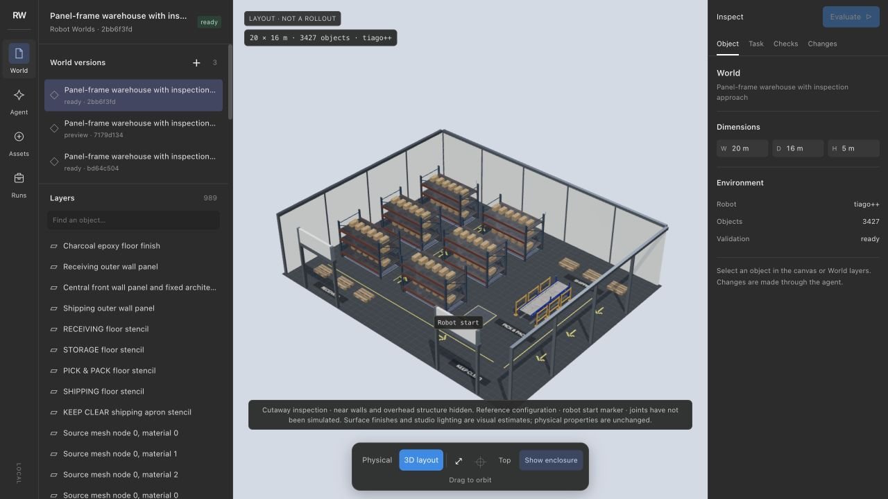

# Robot Worlds

Describe a place and a task. Generate a physical robot world and editable rubric, run a policy, and inspect what happened.

Robot Worlds is an early self-hosted robotics project. Simulation runs locally with MuJoCo; generation and the default robot agent use your OpenAI API key. A factory is the first reference setting. The scene format also supports workshops, homes, labs, warehouses and other arrangements of rigid objects and articulated mechanisms.



*Actual workbench capture. Live-generated layout with original source assets and a validated texture-mapping edit.
It does not demonstrate autonomous warehouse logistics.*

## Run locally

Requires Python 3.11 or later and [uv](https://docs.astral.sh/uv/getting-started/installation/). Physical execution is tested on Apple silicon macOS and Linux with NVIDIA EGL rendering. Use `MUJOCO_GL=egl` on a compatible headless NVIDIA host.

```sh
git clone https://github.com/playground-systems/robot-worlds.git
cd robot-worlds
uv sync
# Optional: generation and model-driven evaluation require a key.
# export OPENAI_API_KEY="your-key"
uv run robot-worlds serve
```

Open **http://127.0.0.1:8765**. Choose **Browse starter environments** for an Astra-authored SimReady kitchen, factory or living room with selectable manipulation tasks, or one of four static reference layouts. Adding a starter needs no model key. Or enter a scene and task, inspect the generated geometry and rubric, then start an evaluation. The workbench stores worlds, job progress and reports under `.robot-worlds/`. A failed validation preserves its candidate and explains the failed checks.

Follow the [end-to-end walkthrough](docs/walkthrough.md), or see the [SDK and sensor contract](docs/sdk.md) for custom policies and appliance environments. See [setup and model access](docs/setup.md) for offline `doctor` checks, API requirements, the optional Codex SDK transport, and clean installation.

The [manipulation preset guide](docs/manipulation-presets.md) covers the three SimReady scenes and 44 named tasks. Native reset and rubric checks pass; robot task completion remains unverified. The [starter environment guide](docs/starter-environments.md) covers the static source layouts, offline SDK use and adaptation limits.

For reusable warehouse models, install the reviewed rack, pallet, carton,
barrier and passive conveyor into the workbench's asset library:

```sh
uv run robot-worlds prepare-warehouse
```

First preparation needs Node.js 20+; it makes no model calls. Source geometry,
textures and attribution are retained. [Setup details](docs/setup.md) explain
subset selection and CLI use. The [release evidence](docs/alpha-acceptance.md) separates validated generation,
navigation and engineering manipulation from autonomous task success.

```python
from robot_worlds import generate, LLMAgent

world = generate(
    "Build a workshop with separate parts storage and inspection areas. "
    "Use TIAGo++. The task is to carry a small part from storage to inspection."
)
report = world.evaluate(LLMAgent(), max_steps=30, max_sim_seconds=120)
report.open()
```

Generation can return an **unvalidated** world. Inspect `world.manifest["validation"]` before evaluation; the SDK refuses to run a version that did not pass its checks. A validated reset is evidence of a loadable, stable scene—not proof that its task is solvable.

## What runs

- **Generation:** Astra produces a scene and rubric, checks their references and geometry, compiles and settles the physical world, and repairs failures within a bounded number of attempts. Every saved version has a content address.
- **Editing and repair:** text requests patch persistent scene entities, preserve prior versions and produce computed before/after diffs. Optional scope limits which objects can change; repair preserves the task and physical properties. [Scene editing](docs/scene-editing.md) explains the contracts.
- **Robot tools:** the agent selects bounded motion, arm, gripper and sensing actions. Controllers execute these actions in MuJoCo. Object motion comes from physical contact.
- **Evaluation:** local checks grade the recorded state. Criteria support object identity, contact, containment, grasping, temporal order, holding duration and alternatives. Inference wall time is separate from simulated time.
- **Inspection:** watch a live spectator camera, the current robot action and provisional milestones while evaluation runs. The final report independently rechecks the full trace. Worlds and runs export as ZIP archives.

TIAGo++ is the primary robot, using the pinned MuJoCo Menagerie model with documented wheel and gripper collision approximations. Experimental Unitree G1 uses the 29-DOF body, Dex1 parallel grippers and an official walking policy. Engineering tests cover contact grasping, carrying and flat-ground locomotion; arbitrary terrain and payloads remain unvalidated. See [the implementation evidence and remaining work](docs/product-goal.md).

For larger facilities, select the large-scene generation profile. For repeated evaluations, the SDK, API and CLI support isolated workers and explicit EGL rendering. MuJoCo physics remains CPU-based. [Parallel evaluation](docs/parallel-evaluation.md) explains the controls and per-episode budgets; [GPU validation](docs/gpu-validation.md) records the measured limits.

## Physical boundaries

The first release models rigid bodies and articulated mechanisms. Internal machining may be represented by an explicit timed process with physical loading prerequisites and persistent workpiece identity. That abstraction appears in the saved specification and report. Cutting, welding, fluids, cloth and material deformation are outside this release.

Mass, friction and visual material defaults are estimates. Policies receive onboard RGB-D, joint encoders and relative IMU measurements; TIAGo also has wheel-encoder odometry. Object labels and global positions are not supplied. Sensor noise is not yet calibrated to hardware. Arm commands use robot-base coordinates. The arm controller uses local inverse kinematics; it does not guarantee a collision-free motion plan. Evaluation keeps rubric and full simulator state outside the policy observations.

## Development

```sh
uv sync --dev
uv run pytest
uv run ruff check src tests
```

Tests use generated engineering fixtures and bounded fake transports where appropriate. Live model calls require explicit opt-in:

```sh
ROBOT_WORLDS_LIVE_API=1 uv run pytest tests/test_llm_live.py
```

Read [Contributing](CONTRIBUTING.md) for focused checks, [Security](SECURITY.md) for reporting, and [release preparation](docs/releasing.md) for packaging gates.

The root code is MIT licensed. Robot models, controller weights and vendored browser libraries retain their own licenses and source attribution beside the assets. The [third-party inventory](THIRD_PARTY_NOTICES.md) records the pinned sources and retained terms.
