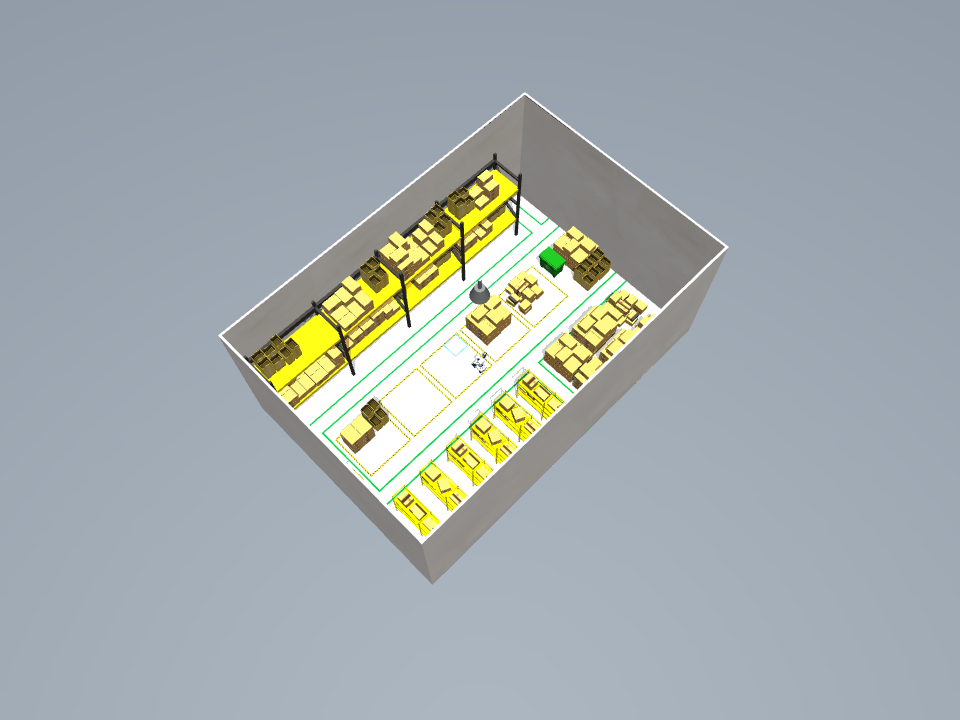
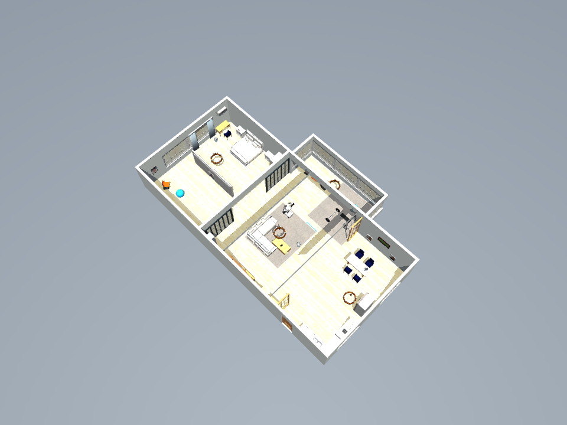
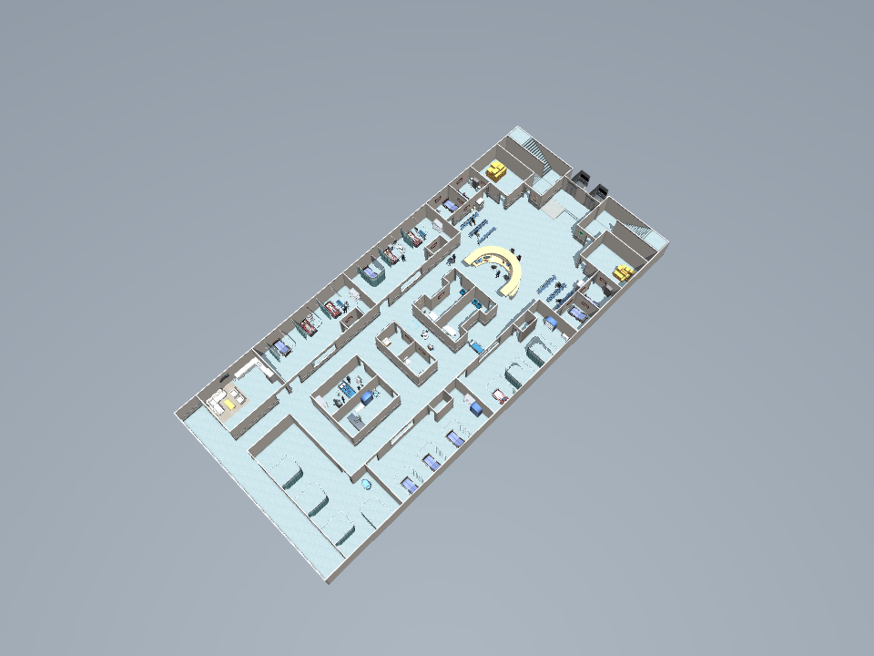
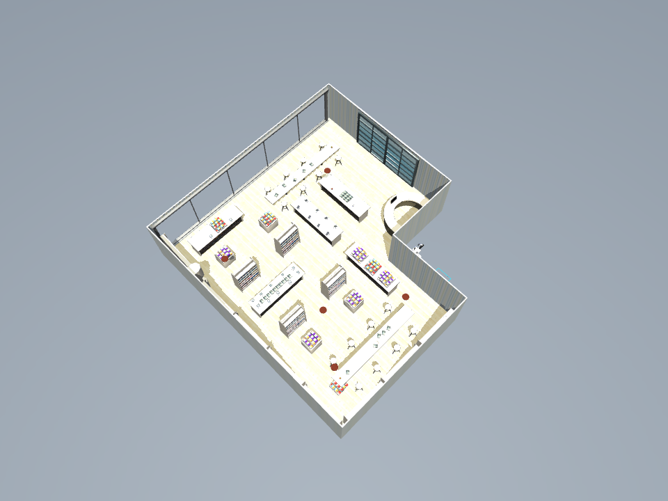

# Starter environment acceptance

All four bundled scenes passed native MuJoCo reset, settling, initial rubric
and rendering checks. The public API imports them through the normal spawned
worker; the SDK reopens the same immutable versions. All four remain available
after restarting the application. These checks make no model calls and do not
run a robot policy.

| Environment | Source instances | Components | Bundle | Mac import |
| --- | ---: | ---: | ---: | ---: |
| Small warehouse | 25 | 692 | 4.8 MB | 0.55 s |
| Furnished house | 87 | 1,545 | 43.1 MB | 0.78 s |
| Hospital | 181 | 9,198 | 64.9 MB | 3.18 s |
| Bookstore | 139 | 3,243 | 15.9 MB | 0.99 s |

Import times measure local API submission through completed unpacking on the
review Mac. They exclude browser mesh loading and native validation. No network,
key, conversion or simulation is required to add a starter. Linux verification
runs measured 0.49–4.81 seconds per import.

The [machine-readable evidence](evidence/starter-environments-2026-11-02.json)
records source revisions, bundle hashes, native checks, simulator memory and
Linux/Mac API and SDK results. The [native preparation run](https://github.com/playground-systems/robot-worlds/actions/runs/41492179245)
contains the full validation records. The [package-only check](https://github.com/playground-systems/robot-worlds/actions/runs/41511111605)
passed offline imports on the matching installation and verified complete
wheel/source archives with preparation folders excluded. It ran no simulation.

The images below are native reset renders. The hospital ceiling is hidden for
inspection; the runtime's background plane is hidden in every thumbnail so it
does not overlap original source flooring. Saved physics and policy cameras
retain the complete scene.

| Warehouse | Furnished house |
| --- | --- |
|  |  |
| Hospital | Bookstore |
|  |  |

Imported equipment is fixed and not certified for manipulation. The navigation
task and initial checks do not demonstrate autonomous success or certify every
route. Local evaluation requires compatible native validation; a different
installation can use **Checks → Validate on this computer** without a model key.

To reproduce the offline import check after installation:

```sh
python tools/starters/check_installed.py
```

See [starter environment sources and adaptations](starter-environments.md).
