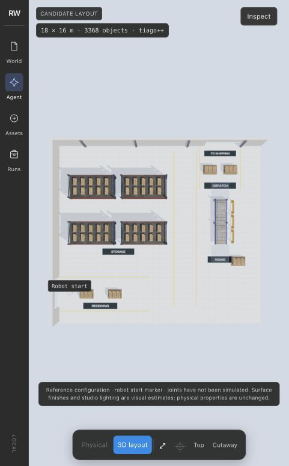
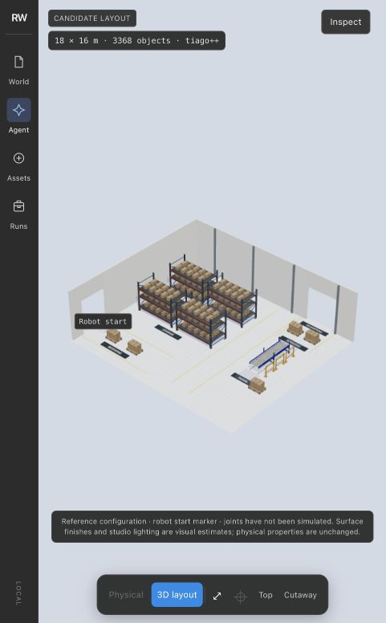
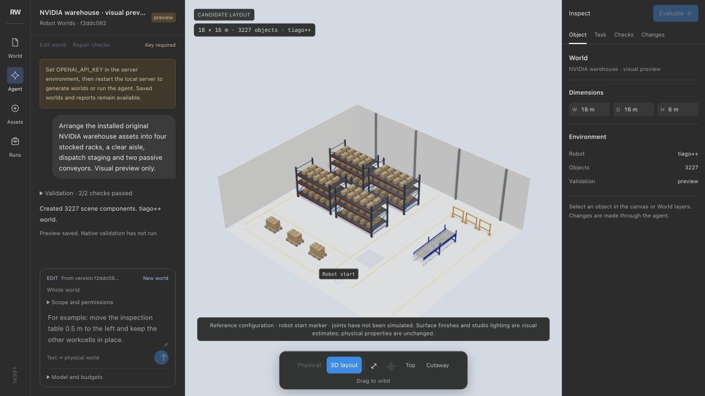
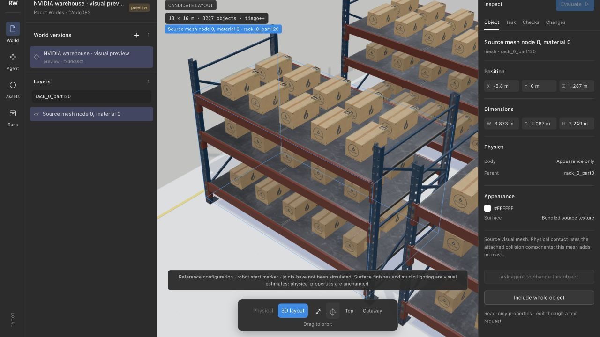

# Warehouse viewer with viz3d

Use CodePawl's [viz3d skill](https://github.com/codepawl/viz3d), pinned at
`0e514213b811fc6ffb8e5a7e33891f201f415fff`, for the existing application's
embedded Three.js view. The upstream project supplies guidance and audit helpers,
not a replacement renderer package. Keep the Figma-style application shell and
the existing world, asset, selection and evaluator contracts.

## Capture plan

- Subject: receiving → storage → manual packing → passive roller transfer →
  dispatch → shipping. Four stocked racks connect to clear walking aisles;
  both conveyor ends have operator space, and side guarding protects the line.
- Reuse the already prepared NVIDIA/CodePawl meshes and original textures at
  source dimensions. Preserve physics geometry and provenance.
- Assemble a reproducible plan through the generation pipeline with a deterministic
  client. Label it a visual preview, with no live-model or physical-validation claim.
- Use viz3d's clean operations look: calm industrial ground, readable lighting,
  source materials, an unobstructed overview and equipment close-up.
- Keep rendering demand-driven, cap pixel ratio at 1.5 and suspend offscreen work.
  Camera shortcuts must be local to the focused viewport.
- Capture actual application pixels after assets finish loading. Inspect missing
  textures, clipping, overlap, framing and interface obstruction before delivery.

This task runs no CI, paid model calls, native simulation, asset conversion or
video encoding. Reuse cached files and keep browser inspection bounded. Stop any
temporary server started for capture. Successful screenshots establish visual
rendering only; physical contacts and a live generated warehouse remain separate
acceptance gates.

## Evidence

### Connected workflow revision

The first preview placed the conveyor as an isolated prop. The revised layout
has a west receiving opening and a north shipping opening, each with nearby
pallet staging. Packing feeds the south end of the aligned roller modules;
the north end opens onto an unloading area before dispatch. The barriers run
alongside the line instead of across its destination. Floor stencils identify
the zones in the actual rendered scene.





The revised preview has 3,368 components and passes static geometry/rubric checks.
Cached preparation and saving took 3.22 seconds. It remains deterministic and
not natively validated. Rollers are unpowered: loading, pushing and unloading
are manual handoffs, including the height change to pallets. No automatic
transfer or throughput is claimed. [Evidence](images/nvidia-warehouse-flow/evidence.json).

Generation instructions now require purpose, upstream/downstream connections,
accessible handoff areas, useful guarding and openings before equipment placement.
This is planning guidance, not a new automatic semantic validator.

### Earlier asset-rendering capture

Actual application captures on October 31:





The 18 × 16 m preview contains 3,227 physical/visual components. Cached assembly
and portable-world saving took 3.94 seconds, excluding browser loading. Static
checks passed; native validation was deliberately not run. Navigation analysis
remains unknown because its exact arrangement exceeds the cell budget. This uses a
deterministic plan, not live model generation. [Capture evidence](images/nvidia-warehouse/evidence.json)
records the world identity, viewer file hashes and screenshot hashes.

The viewer follows viz3d's clean-operations palette and 30° camera, with source
materials preserved. It caps pixel ratio at 1.5, pauses frames and queued asset
loads offscreen, and scopes Home/F shortcuts to the focused canvas. Actual
inspection found poor caption contrast and a removed shadow-map setting; both
were corrected before these captures. This is a first sourced warehouse preview,
not visual parity with the larger reference or proof of physical usability.

Thirty-four focused CPU viewer checks and the local module-resolution check pass.
No CI, model call, native simulation, conversion or build ran for this capture.
Upstream guidance is MIT-licensed; no upstream helper code was copied. NVIDIA
asset attribution remains in each portable world.

Reproduce with already prepared libraries:

```sh
python tools/demo/warehouse_preview.py \
  --library .robot-worlds/asset-library \
  --conveyor-library .robot-worlds/conveyor-library \
  --output .robot-worlds/warehouse-preview
robot-worlds serve --data-dir .robot-worlds/warehouse-preview --port 8766
```

Open the printed world in the app. Select a rack visual in Layers and choose
“Fit selected object” for the detail view. Stop the temporary server afterward.
